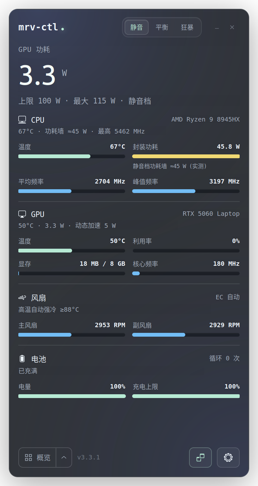
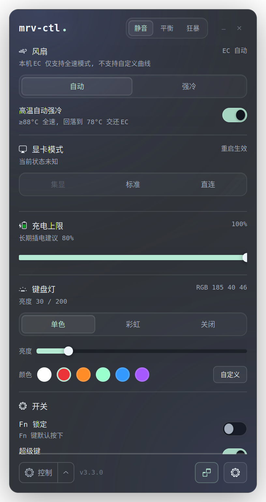
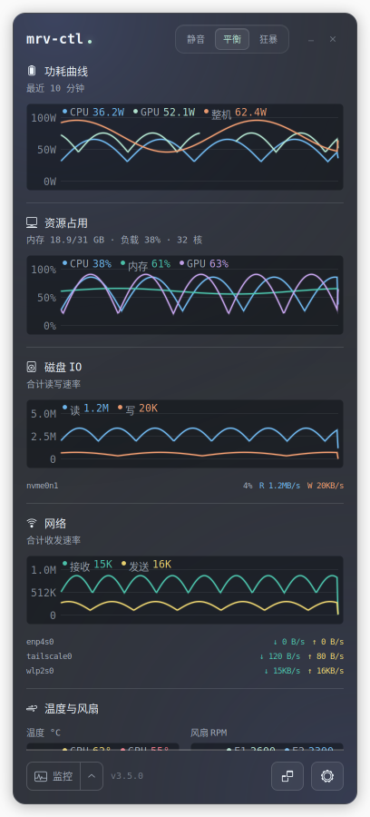

# mechrevo-linux-control

**机械革命（Uniwill 准系统）游戏本的 Linux 控制台** —— 在 Ubuntu 上找回 Windows 官方控制台的性能模式、独显功耗、风扇强冷、键盘 RGB、电池限充与独显直连。

> Linux control center for MECHREVO (Uniwill barebone) gaming laptops: performance profiles, NVIDIA Dynamic Boost, fan boost, keyboard RGB, charge limit, MUX, local performance monitoring and RTD3 — with every hardware claim backed by on-device measurements.

| 概览 | 控制 | 监控 |
|---|---|---|
|  |  |  |

---

## 为什么需要它

机械革命 40/50 系游戏本装上 Ubuntu 后有三个典型问题：

- **独显被锁在 50W**：Ubuntu 的 NVIDIA 驱动包缺少 `nvidia-powerd` 的 systemd unit 和 D-Bus 策略，Dynamic Boost 不工作。
- **没有官方控制台**：性能模式、风扇、灯效、限充只能在 Windows 的官方控制台（GCU 服务）里调。
- **现成方案不适配**：TUXEDO Control Center 在这类机器上读不到机型 ID，风扇 API 不可用，还会和其它工具互相覆盖设置。

mrv-ctl 直接对接固件已经提供的通道（EC 寄存器、DSDT 方法、内核 `uniwill_laptop` 驱动、`nvidia-powerd`），不依赖 Windows 服务，也不修改 NVIDIA 驱动。

## 功能

| 功能 | 状态 | 说明 |
|---|---|---|
| 独显功耗解锁 50W → 115W | ✅ | 安装时自动修复 `nvidia-powerd`（NVPCF / Dynamic Boost） |
| 性能模式 静音 / 平衡 / 狂暴 | ✅ 实测生效 | EC 固件按档位切换 CPU 功耗墙；同时管理 CPU EPP 与睿频，静音档额外关睿频 |
| 风扇强冷 | ✅ | EC 全速模式，2 秒内 2900 → 4690 RPM |
| 高温自动强冷 | ✅ | 默认 ≥ 88°C 全速、≤ 78°C 交还 EC 曲线，阈值可调 |
| 键盘灯 | ✅ | EC 通道与 ITE 8291 USB 通道双后端；亮度、RGB、彩虹、离电自动关灯 |
| 电池限充 | ✅ | 20–100% |
| 独显直连（MUX） | 🧪 实验 | 标准 / 直连 / 集显三模式，写 EFI 变量，重启生效 |
| 功耗墙校准 | ✅ | `mrvctl calibrate` 在本机实测各档 CPU 功耗墙 |
| Fn 锁定 / 超级键 / 睡眠呼吸灯 | ✅ | 按机型能力自动显示 |
| 本机性能监控 | ✅ | 功耗、CPU/内存/GPU 占用、磁盘 IO、网络、温度/风扇、每核占用，最近 10 分钟曲线 |
| 独显 RTD3 | ✅ 实测 | 空闲时进入 D3hot/D3cold；遥测自动避让，不会把独显反复唤醒 |
| 自动更新 | ✅ | 检查 GitHub Release、下载 `.deb`、`pkexec` 授权安装 |
| 自定义风扇曲线 | ❌ | 本机 EC 不支持，7 次受控实验的结论见 [硬件笔记](docs/hardware.md#风扇控制) |
| 独显超过 115W | ❌ | Linux 下没有安全通道（Windows 上的做法是改 NVIDIA 驱动内部对象） |

界面有托盘常驻、可拖动的悬浮窗（CPU / GPU 温度与 GPU 功耗）、可自由缩放的窗口，以及完整的命令行工具。

## 实测性能释放

验证机型：机械革命苍龙（`CANGLONG Series-M6DR55xx`，Ryzen 9 8945HX + RTX 5060 Laptop，BIOS `N.1.16MRO13`），Ubuntu 24.04 + 内核 7.0 HWE + NVIDIA 595。

| 档位 | CPU 满载稳态 / 峰值 | CPU 频率 | Tctl 最高 | 独显负载功耗 | 独显功耗上限 |
|---|---|---|---|---|---|
| 静音 | 45.6 / 45.8 W | 2064 MHz | 66°C | 90.6 W | 105 W |
| 平衡 | 86.9 / 86.9 W | 4281 MHz | 80°C | 83.9 W | 85 W |
| 狂暴 | 122.7 / 130.7 W | 4656 MHz | 97°C | 94.4 W | 115 W |

CPU 负载为 `openssl speed` 32 进程 45 秒，独显负载为 `glmark2` 4K 离屏渲染 40 秒。原始数据在 [`docs/perf/`](docs/perf/)，测试方法和 A/B 对照见 [硬件笔记](docs/hardware.md#性能模式)。

## 支持机型

| 机型 | 状态 |
|---|---|
| 机械革命 苍龙（M6DR55xx, R9 8945HX + RTX 5060） | ✅ 完整实测 |
| 机械革命 苍龙 16X Pro（ITE 8291 键盘灯） | 🧪 键盘灯通道已适配（来自社区 Fork） |
| 其它机械革命 / Uniwill 准系统游戏本 | ⚠️ 未验证：能装，功能按探测结果开放，不套用任何功耗数值 |

mrv-ctl 启动时会识别机型（DMI、BIOS、EC 平台代际、CPU、GPU），并按 DSDT 里是否存在对应的 ACPI 方法决定开放哪些功能。可以用 `mrvctl info` 查看本机的识别结果。欢迎提交新机型，流程见 [参与贡献](#参与贡献)。

## 安装

### 环境要求

- Ubuntu 24.04（其它 Debian 系发行版未测试）
- 内核自带 `uniwill_laptop` 驱动（主线 6.19 起；Ubuntu 24.04 HWE 7.0 已包含）
- NVIDIA 官方驱动（含 `nvidia-powerd`）；**内核升级后需同步 `linux-modules-nvidia-<ver>-$(uname -r)`**
- 依赖：`acpi-call-dkms`、`python3-gi`、`python3-gi-cairo`、`gir1.2-gtk-3.0`、`gir1.2-ayatanaappindicator3-0.1`（安装时自动拉取）

### 从源码安装

```bash
git clone https://github.com/ss12wzh/mechrevo-linux-control.git
cd mechrevo-linux-control
sudo ./install.sh          # 构建 deb 并安装，不需要重启
```

安装后会自动：加载 `acpi_call` 与 `uniwill_laptop`、配置开机自动加载、启用守护进程 `mrvd`、修复 `nvidia-powerd`、写入 NVIDIA RTD3 参数与 udev 规则、添加桌面入口和托盘自启动。卸载：`sudo apt remove mrv-ctl`。

> **不要和 TUXEDO Control Center 同时使用。** 两者都会写 EC、CPU 策略和键盘灯，会互相覆盖。mrv-ctl 需要的接口全部由内核自带的 `uniwill_laptop` 提供，不需要 `tuxedo-drivers`。

## 使用

### 图形界面

从应用菜单打开 **mrv-ctl 机械革命控制台**，或运行 `mrv-gui`。

- **概览**：GPU 功耗、CPU / GPU / 风扇 / 电池实时状态，CPU 功耗条按当前档位的功耗墙计算。
- **控制**：风扇强冷与高温自动强冷、显卡模式、充电上限、键盘灯、Fn 锁定等开关。
- **监控**：最近 10 分钟曲线——功耗（CPU 封装 / GPU / 电池侧整机）、资源占用（CPU / 内存 / GPU）、磁盘读写、网络收发、温度与风扇、每核占用；独显休眠时段断线显示。
- 左下角按钮循环切换三页，也可用展开菜单直达；窗口可自由缩放并记住尺寸/位置。
- 右下角设置菜单含窗口置顶、悬浮窗、校准功耗墙、检查更新；页脚版本号可点击检查更新。

### 命令行

```bash
mrvctl status                      # 整机状态
mrvctl profile office|balanced|boost
mrvctl fan boost                   # 强冷（全速）
mrvctl fan auto                    # 交还 EC 固件曲线
mrvctl fan guard on 88 78          # 高温自动强冷：≥88°C 开，≤78°C 关
mrvctl kbd 150                     # 键盘灯亮度 0-200
mrvctl kbd color 0 120 200         # RGB 颜色
mrvctl kbd effect rainbow          # solid | rainbow | off
mrvctl charge 80                   # 充电上限
mrvctl mux query                   # 显卡模式状态
mrvctl mux dgpu --yes              # 切换到独显直连（重启生效）
mrvctl info                        # 机型识别 / 档案 / 能力门槛
mrvctl calibrate                   # 本机实测各档 CPU 功耗墙（约 2 分钟，会满载 CPU）
```

写操作需要 root 或 `sudo` / `mrv` 组成员，读状态任何用户都可以。

## 工作原理

```text
mrv-gui (GTK3, 普通用户)      mrvctl (CLI)
          └────────┬───────────┘
                   │  Unix socket /run/mrvd/mrvd.sock（SO_PEERCRED 鉴权）
                   ▼
              mrvd (root)
        ┌──────────┼──────────┬─────────────┐
        ▼          ▼          ▼             ▼
   /proc/acpi/call  hwmon   EFI/MUX    nvidia-smi
   EC 读改写仲裁    温度/风扇  显卡模式    RTD3/功耗
```

- **守护进程 `mrvd`**：唯一碰硬件的进程，root 运行；EC 写入有白名单、基线、写后读回、跨进程锁四道保险。
- **GUI / CLI**：只通过 Unix socket 与守护进程通信，普通用户权限。
- **2 秒资源采样**：CPU 每核占用、内存、磁盘速率/利用率、网卡收发、电池侧功率，随 `status` 下发；曲线只在 GUI 内存里滚动，不落盘。

更细的模块说明、数据契约、构建方式与排错见 [开发文档](开发文档.md)。

## 已知限制

- **系统睡眠**：本机只支持 `s2idle`，历史上有睡死记录；本项目已做睡前冻结与唤醒恢复，但不能保证 100% 可靠。
- **内核升级**：必须安装与当前内核匹配的 NVIDIA 模块，否则独显既不能监控也不能休眠（界面会提示）。
- **空载功耗**：2560×1600@240Hz 桌面合成会让核显常驻高负载，这是整机功耗大头；需要更低功耗可降刷新率。
- **风扇曲线**：硬件只提供全速位，不支持自定义曲线。

## 目录结构

| 路径 | 内容 |
|---|---|
| `mrvd.py` | root 守护进程：EC 读写仲裁、性能模式、风扇、限充、灯效、MUX、遥测、睡眠、IPC |
| `mrv-gui` | GTK3 图形界面（普通用户运行） |
| `mrvctl` | 命令行客户端 |
| `mrvupdate.py` | 自动更新检查/下载/安装 |
| `mrvmodel.py` / `data/models.json` | 机型识别、能力门槛、功耗墙校准 |
| `debian/`、`build-deb.sh`、`install.sh`、`mrvd.service` | 打包与安装 |
| `scripts/` | 只读探测、风扇实验、性能测量工具 |
| `docs/` | 硬件笔记、ACPI 反汇编、实验与测量数据 |
| `说明书.md` / `开发文档.md` / `DEVELOPMENT.md` | 用户说明 / 开发文档 / 开发者速查 |

## 参与贡献

- 新机型适配：用 `mrvctl info` 附上识别结果、DSDT 方法列表与 `docs/probe/` 的只读探测日志开 issue。
- 改代码前请先读 [开发文档](开发文档.md) 第 12 章的 EC 安全红线；所有硬件结论要求附实测证据。
- 发布：推送 `v*` tag 会触发 GitHub Actions 构建 deb 并发布 Release，GUI 的自动更新会读取该 Release。

## 许可证

MIT，见 [LICENSE](LICENSE)；第三方文件例外见 [NOTICE](NOTICE)。
